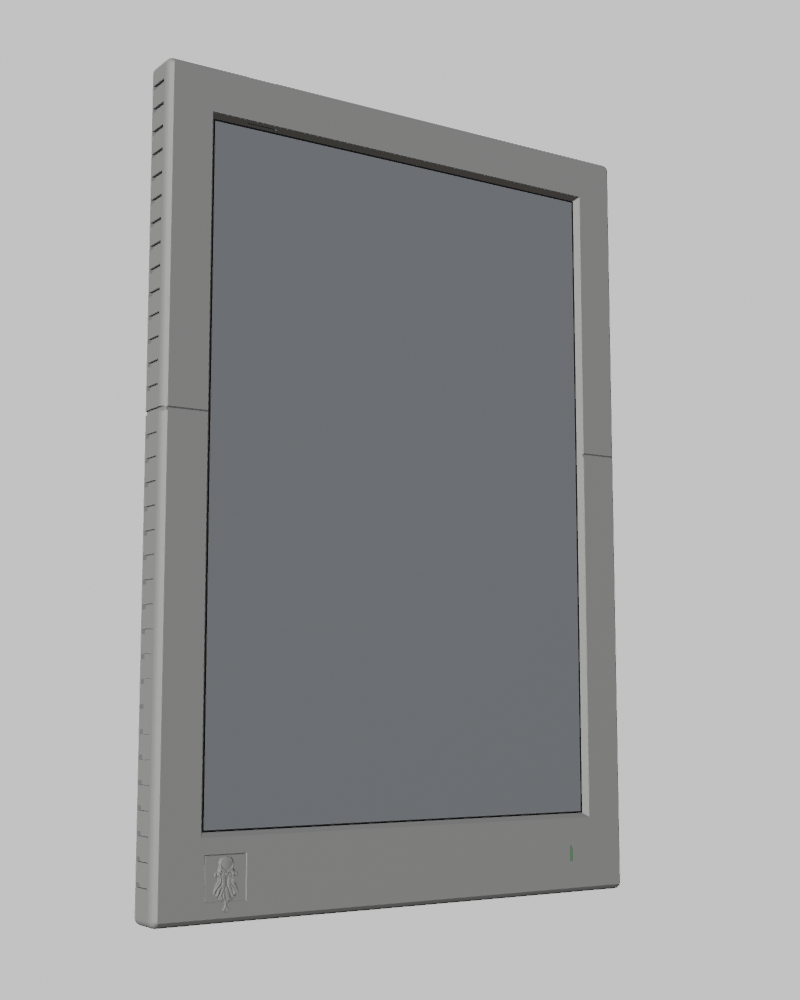
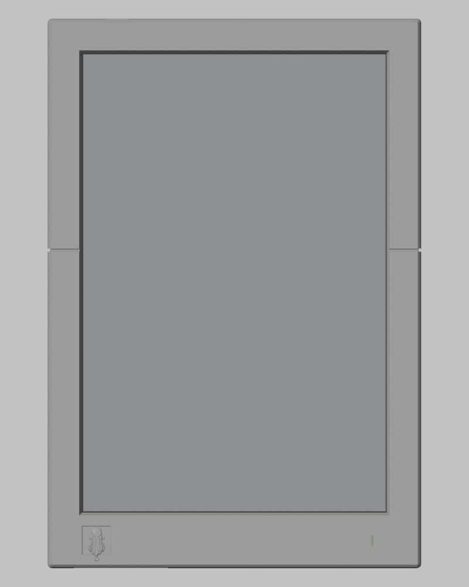
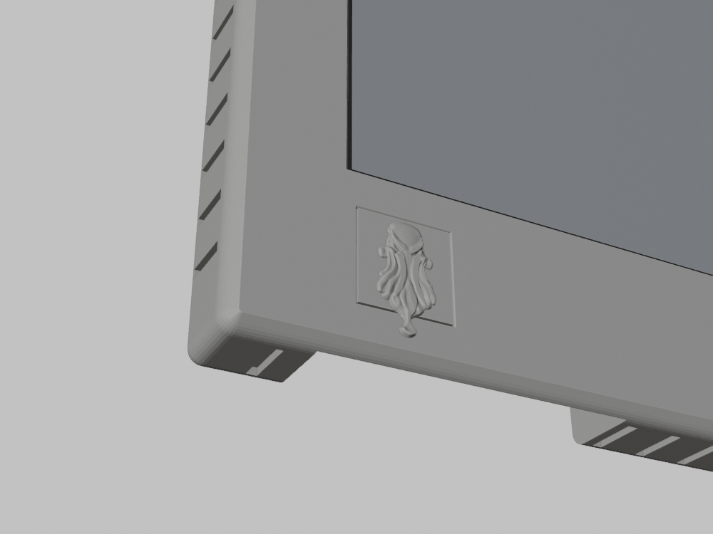

# ZSUS 14" Portrait Mount & Apple "Snow White" Open-Back Bezel (v21)

A 3D-printed, tool-free bezel that turns the ZSUS 14" 2K portable monitor into a portrait display in the spirit of
Apple's 1980s "Snow White" design language and the Apple IIc monitor, plus a glue-on ball socket that hangs it on an
articulated arm. Every part is generated from source and gated (fits, strains, styling), then sliced to verify.

<p align="center">
<picture><source media="(prefers-color-scheme: dark)" srcset="docs/images/three_quarter_dark.png"></picture>
<picture><source media="(prefers-color-scheme: dark)" srcset="docs/images/front_dark.png"></picture>
</p>

<p align="center">
<picture><source media="(prefers-color-scheme: dark)" srcset="docs/images/chin_dark.png"></picture>
<picture><source media="(prefers-color-scheme: dark)" srcset="docs/images/emblem_dark.png"></picture>
</p>

<p align="center">
<picture><source media="(prefers-color-scheme: dark)" srcset="docs/images/socket_dark.png"></picture>
<picture><source media="(prefers-color-scheme: dark)" srcset="docs/images/tile_dark.png"></picture>
<picture><source media="(prefers-color-scheme: dark)" srcset="docs/images/back_dark.png"></picture>
</p>

Target printer: Bambu Lab P1S (256 x 256 x 256 mm), **0.4 mm nozzle**, Textured PEI plate.
Material: Generic PLA / PLA+ / Matte PLA. Monitor: ZSUS 14" 2K (PM14A-2K), see `Monitor_Dimensions_and_Ports.md`.
What changed between releases is in `CHANGELOG.md`; open work in `ROADMAP.md`.

## Files
| File | What it is |
| :--- | :--- |
| `ZSUS_v21_Complete_P1S_PLA.3mf` | Bambu Studio project: 5 plates, per-object settings, slices with no warnings |
| `ZSUS_v21_Assembly_Instructions.pdf` | Print order, fit tests, assembly, disassembly, printing notes |
| `STLs/Part_A_Test.stl` | 26.0 x 26.0 x 18.4 mm socket coupon: the mount's exact socket and collar relief, for the collar + ball test |
| `STLs/Part_A_Mount.stl` | 85.0 x 100.0 x 21.3 mm VHB glue-on ball socket |
| `STLs/Part_B_FitGauge.stl` | 52.2 x 55.0 x 18.6 mm: 15 mm of the thick-side channel plus three thin-side channels with 7.0 / 7.4 / 7.8 mm slots (1 / 2 / 3 notches) |
| `STLs/Part_B_SeamTest_Upper.stl`, `STLs/Part_B_SeamTest_Lower.stl` | 22.3 x 21.4 / 16.2 x 18.6 mm: the thin-side corner of each half round the parting line, cut from the real parts: the snap arm and its square hook, the notch and its ledge |
| `STLs/Part_B_Lower.stl` | 242.2 x 211.0 x 18.6 mm lower bezel: chin, emblem window + slit light, side channels, lap tongue, snap catch |
| `STLs/Part_B_Upper.stl` | 242.2 x 156.2 x 18.6 mm upper bezel: USB-C bay, snap arm, top-right detent tab |
| `STLs/Part_B_Emblem.stl` | 18.0 x 18.0 x 11.1 mm snap-in chin emblem tile (blank face), removable from behind |
| `STLs/Part_B_Emblem_Cthulhu.stl` | 18.0 x 22.4 x 12.3 mm emblem tile with the Cthulhu head as an onlay (CC BY, see below) |
| `STLs/Part_B_LED.stl` | 4.0 x 9.4 x 3.8 mm press-fit plug for the vertical slit power light |
| `CAD/` | Generators and checks (below); `CAD/layout.json` is the project (plates, settings, support regions, limits); `CAD/renders/` holds the guide figures and the last slice report |
| `CAD/assets/cthulhu/` | The Cthulhu statue mesh by ChurchOfShrike (CC BY) and its `ATTRIBUTION.md` |
| `docs/images/` | The pictures above, rendered from `STLs/` by `CAD/render_views.py` |
| `v20_archive/` | The v20 release as received, untouched |

## Plates (from the last slice, `CAD/renders/slice_report.json`)
| Plate | Contents | Settings | Time | PLA |
| :--- | :--- | :--- | :--- | :--- |
| 1 Fit tests (print first) | Part_A_Test, Part_B_FitGauge, Part_B_SeamTest_Upper + _Lower | A: 0.16 mm, 5 walls, 40% gyroid, brim; gauge and seam test: 0.20 mm, 3 walls, 15%; tree supports under the seam test's snap-arm tip | 1.1 h | 23 g |
| 2 Part A mount + accents | Part_A_Mount, Part_B_Emblem, Part_B_LED | 0.16 mm; mount 5 walls 40% gyroid; accents 3 walls 100% | 1.3 h | 33 g |
| 3 Part B lower bezel | Part_B_Lower | 0.20 mm, 3 walls, 15% gyroid, no brim | 3.0 h | 97 g |
| 4 Part B upper bezel | Part_B_Upper | 0.20 mm, 3 walls, 15% gyroid, no brim; tree supports from the plate under the snap-arm tip and the left lap corner only | 2.3 h | 72 g |
| 5 Cthulhu emblem (optional) | Part_B_Emblem_Cthulhu | 0.08 mm, 3 walls, 100%, tree supports from the plate | 0.4 h | 4 g |

Global: supports off; a part that needs them turns them on for itself (plate 5's tile; the Upper, as enforcer volumes
named in `STLs/Part_B_supports.json`, so the GUI's global support switch does not change it), aux fan 10%, avoid
crossing walls on (keeps travel off the screen opening), Generic PLA. Part B prints face-down (front on the plate).
The project tints the filament warm light grey (`#D3CFC6`, near Apple "Platinum"; Snow White products were never
bright white): load a matte warm-grey PLA for the bezel to match, and dry it first (about 55 C for 8 h): wet PLA
strings. Snap the Upper's two supports off before assembly.

**Print plate 1 first.** Part_A_Test must take the Polbecky collar smoothly, snap the 17 mm ball in, and lock it when
the collar is hand-tight without the ball popping out, and without the collar bottoming on the coupon first. The thick
gauge piece must slide onto the monitor's thick edge with light friction. For the thin edge, the first of the three
notched pieces (1, 2, 3 notches = 7.0, 7.4, 7.8 mm slot) that slides on without rocking sets the panel thickness:
1 notch keeps `MON_THIN = 6.5`; 2 or 3 means raise `MON_THIN` in `CAD/monitor_spec.py` by 0.4 or 0.8 mm and rebuild
before printing plates 3 and 4. Thick edge off: adjust `MON_THICK` (same file) / `FIT_X` the same way. The two seam
test pieces must snap together along the seam with a click and hold when pulled apart; pressing the finger tab toward
the screen side releases them.

## Rebuild everything
```bash
CAD/build_all.sh
```
Needs `uv`, Blender >= 4.5 (MANIFOLD boolean solver; tested on 5.3.0), Bambu Studio (tested on 02.09.01.70) and
[gates_of_heck](https://github.com/ztomer/gates_of_heck) at `$GOH_DIR` (default `~/Projects/gates_of_heck`): its CAD
layer judges the STLs, the socket's leaf strain and the sliced project, for this build and for the push gate, from
`CAD/layout.json`. Each step refuses to continue on failure, and every gate below has been seen to fail on a known-bad
part (`CHANGELOG.md` names each):

| Step | Script | Gate |
| :--- | :--- | :--- |
| Part A | `CAD/build_part_a_v21.py` (manifold3d) | watertight single shell; a rigid 17 mm ball fits at the design centre AND is captured above its equator; the collar keeps >= 1.5 mm travel after it meets the crown for 19.2..19.95 mm apertures; leaf bending strain snapping the ball in <= 1.5 % (gates_of_heck `checks/cad_strain.py` over the spec the generator writes, `STLs/Part_A_socket.strain.json`; 0.99 % now) |
| Relief | `CAD/make_relief.py --self-test` | handedness end to end: a feature on the source's right seats on the viewer's right |
| Emblem | `CAD/build_emblem.py` (manifold3d) | arm strain <= 2 % at the deflection that passes the hole; barb grip >= 0.3 mm; arm tips >= 0.3 mm clear of the shoulder as printed and clear of body and spine when deflected |
| Part B | `CAD/build_part_b_blender_v21.py` (Blender, headless) | every boolean result manifold; each part one shell (gauge two), outward-facing; nothing written unless all pass |
| Fit | `CAD/check_part_b_fit.py` | Upper / Lower / monitor overlap 0 for the measured 220 x 311 mm monitor with a 13.6 mm (measured) and 14.0 mm (spec) hump; lips over the monitor back; gauge thin slots measured as the Lower's slot + 0 / 0.4 / 0.8 mm; the thin-side latch: lifted off its seat, the Upper travels 1.5 (+/- 0.2) mm before its barb meets the Lower's ledge and then bears on it across >= 0.6 mm (a square hook); styling: equal visible left / right / top borders, equal groove depth both sides, only the parting-line groove reaches the front edge, the front parting line sits in a groove (borders measured on the screen opening's own run, since the rim round's flanks also lie behind the glass plane); the reveal round the photographed image 0.8 mm on all four sides; emblem (seated by `chin_spec.EMBLEM_PLACE`, asserted a rotation, never a mirror): no overlap seated, face flush, pushed back 0.15 mm it lands on the seat, pulled forward 0.25 mm the barbs catch |
| Emblem art | `CAD/make_relief.py`, `CAD/build_emblem.py --relief` | the Cthulhu head's top inside the tile, the onlay seated in the real Lower with no overlap and on flat chin face all round |
| STL files | `CAD/stl_io.py` (every manifold3d writer), gates_of_heck `checks/cad_mesh.py` | every shipped STL read back as a slicer reads it (vertices joined by exact float32 equality): each edge shared by exactly two faces, consistent winding, positive volume, no zero-area triangle, no zero stored normal (Bambu Studio refuses such a file), the body count `CAD/layout.json` declares (the gauge four) |
| Project | `CAD/build_3mf_v21.py` over `CAD/layout.json`, by gates_of_heck `checks/cad_bambu.py` | P1S 0.4 nozzle profile, every part inside its plate and clear of the exclusion corner; all 5 plates slice with exit 0 and no slicing warnings (read from the CLI's `result.json` and log, where Bambu Studio puts the warnings it shows over the plate); a plate whose part asks for supports has them in its G-code, and an enforced part has support under every region and none more than 15 mm from one; travel over open air (goh `checks/cad_travel.py`, more than 2 mm from that layer's extrusion) at most 250 hops on each bezel plate |
| Guide | `CAD/render_sections.py`, `CAD/build_pdf_v21.py` | figures cut from the shipped STLs; sizes and times read from the STLs and the slice report |
| Pictures | `CAD/render_views.py` (Blender), `CAD/pack_images.py` | the README pictures, light and dark, placed by the same rigid matrices as the fit checks |

## Fit allowances
Sliding channels 0.5 mm per side in X and 0.5 mm glass-to-lip in Z, 0.3 mm at the Y ends. The thick channel is
14.1 mm, so the ZSUS spec thickness (14.0 mm) still slides. The frame is 18.6 mm, which keeps the thick-side lip
1.5 mm thick.

## Bezel styling
After the Snow White rules (2 mm lines on 10 mm centres set back from the front and back, zero-draft walls, 2 mm front
/ 3 mm rear edges, inlaid badge, Fog or Platinum colour) and the 1989 Macintosh Portrait Display:
- Visible frame 22.3 mm on the left, right and top, 36.0 mm chin. The bezel's edge stops 0.8 mm short of the lit image
  on every side (`REVEAL`), measured against the image as the monitor shows it (`IMAGE` in `CAD/monitor_spec.py`),
  which sits 1.2..2.4 mm left of where the spec sheet puts it.
- Lines 2.0 mm wide, 1.5 mm deep, 10 mm pitch on both long sides (35 each, from the parting line), the top (clear of
  the USB-C bay) and the bottom (clear of the control bay), from 5.0 mm behind the face (past the front round) to the
  start of the rear round.
- The Upper / Lower parting line runs through one full-depth side line and a 0.6 mm front-face groove, so it reads as
  a deliberate line.
- 4 mm front round, after the Apple IIc monitor's soft rim (Snow White's own rule is 2 mm). Face-down, the part of a
  round flatter than 45 degrees would droop, so below its 45-degree point it continues as a 45-degree chamfer (a
  teardrop round). 3 mm rear round.
- Taste calls: the 36 mm chin (the Portrait Display's borders are nearly even; this chin is closer to a compact Mac,
  and it houses the control bay) and the shallow 1.65 mm bevel to the glass (the Portrait Display has a deep dark
  surround; open as STYLE.SURROUND in `ROADMAP.md`).

## Chin
The 36 mm chin houses the control bay and takes the Apple IIc monitor's details: the soft front rim above, a vertical
slit power light lower-right (1.6 x 7 mm, `Part_B_LED` pressed in from the back; it is a styling plug, the monitor's
own status LED is in the control bay), and an 18 mm emblem lower-left. The window numbers live in `CAD/chin_spec.py`,
which both the bezel and the emblem generator read.

The emblem is a snap-in tile, so it can be changed without taking the bezel off. The window is stepped: an 18.4 mm
pocket 0.8 mm deep, a 45-degree seat, then a 16.4 mm hole through the 3 mm plate. The tile's cap fills the pocket flush
with the face, its shoulder lands on the seat, and two 0.8 mm cantilever arms from a rear bridge carry barbs that catch
0.35 mm behind the plate. **Fit:** push it in from the front until it clicks. **Remove:** reach into the control bay
from behind and press the bridge forward; the catch faces lean 35 degrees, so the plate cams the arms in and the tile
comes out the front. It prints face-up (the bridge on the bed), so a relief on the face prints as top surfaces.

### Emblem art: the Cthulhu head
The first emblem is the head of **"Chtulhu Statue" by ChurchOfShrike** (MakerWorld model 1705652,
https://makerworld.com/en/models/1705652-chtulhu-statue), used under **Creative Commons Attribution (CC BY)**. The
statue mesh is in `CAD/assets/cthulhu/` with its `ATTRIBUTION.md`; the changes are ours: `CAD/make_relief.py`
(recipe `CAD/emblems/cthulhu.json`) depth-casts the statue from the front, cuts the head and its tentacle beard out of
the shoulders, hands and wings behind it, and compresses it into a 1.2 mm relief on the tile.

It is an **onlay**, 11.1 x 21.7 mm: its dome stays inside the tile's frame and its tentacle beard spills out of the
frame onto the chin face, where it rests, ending on flat face above the bezel's rounded rim. The tile then stops on
the chin face rather than its seat, and still pops out from behind. `CAD/build_emblem.py` gates it seated in the real
Lower: no overlap, a stop when pushed back, and flat chin face under the whole onlay plus 0.5 mm. It prints on plate 5
at 0.08 mm with tree supports under the overhang; break them off the onlay's back, which sits against the chin unseen,
and swap the tile in from the front.

Other emblems: put a model in `CAD/emblems/<name>.json` (`"mode": "onlay"` or `"inlay"`, the art inside the tile's
recessed panel with no supports). Art under a personal-use licence goes in the gitignored `CAD/third_party/`, and
`CAD/build_emblem_art.sh CAD/emblems/<name>.json` builds its relief, tile and one-plate project next to it, out of git.

## Known limits
- The Polbecky collar has no inner lip: its top aperture, about 19.6 mm (+/-0.4, scaled from photos against the 1-inch
  mat grid and the 33.0 mm barrel), squeezes the leaf crown (a 22-degree cone from 19.95 mm down to 17.9 mm). The
  socket stands in a 3 mm relief (r 21.5 mm) so the 9.8 mm collar meets that cone with 2.5 to 3.4 mm of travel left.
  Part_A_Test is how you check it.
- The thin panel is 6.5 mm, set by the fit gauge (only its 7.0 mm slot slides on); the monitor's measurements live in
  `CAD/monitor_spec.py`.
- PLA shrinks about 0.6 % as it cools (one tape reading of the closed bezel); the slicer scales every part by
  1 / 0.994 to compensate (`filament_shrink` 99.4 %, `CAD/layout.json`). Another filament may shrink differently:
  measure the closed bezel (the model is 355.8 mm) and set it from that.
- The monitor is 311.0 mm long by tape (310.5..311); the pocket is 311.6 mm, so the latch, which holds with the seam
  up to 1.5 mm open, covers the reading's spread.
- Part_A_Mount's base (VHB pad, step index, scribe ring, pedestal) has no parametric source: the v20 Fusion script held
  only the boss. The socket is grafted onto that base, read from `CAD/assets/Part_A_Mount_base_v20.stl`.
- The 16.4 mm leaf mouth limits ball tilt at the socket to about +/-25 degrees; the articulated arm supplies the rest.
- Plain PLA only: the leaves stand vertical in the print, so snapping the ball in bends them across the layer lines,
  PLA's weakest direction. Eight leaves, a 0.3 mm snap per leaf and deep slots keep the modelled peak strain at 1.0 %
  (gate: <= 1.5 %). Push the ball in straight and firmly; the collar, not the snap, is what locks it. PETG would add a
  large margin.

## Licence
[Creative Commons Attribution 4.0 International (CC BY 4.0)](LICENSE): print, remix and share it, commercially too, as
long as you credit this project. The Cthulhu emblem is a derivative of "Chtulhu Statue" by ChurchOfShrike (CC BY);
keep that credit too (`CAD/assets/cthulhu/ATTRIBUTION.md`).
